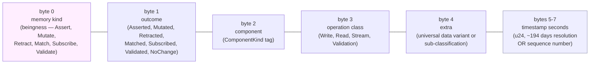
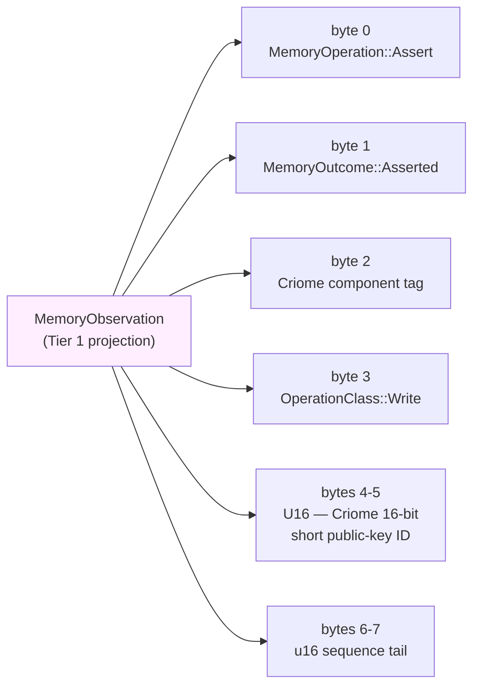
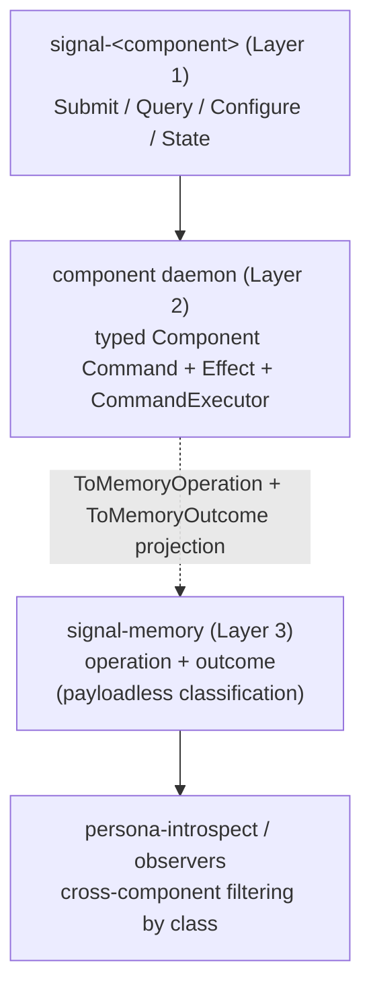

# signal-memory Architecture

`signal-memory` owns the universal Memory classification vocabulary: the
*payloadless* state-action class labels used for cross-component
observation and introspection, plus the read-algebra pattern
primitives, qualitative magnitude vocabulary, and typed identity
values components carry inside their own typed records.

## Direction

`signal-memory` is the home of **Layer 3** in the three-layer model: the universal *payloadless* class labels (`Assert`, `Mutate`, `Retract`, `Match`, `Subscribe`, `Validate`) used for cross-component observation and introspection. Daemons project their Component Commands and effects to Memory classes via `ToMemoryOperation` and `ToMemoryOutcome`; observers filter cross-component activity by class without knowing per-daemon command payloads. `signal-memory` is the universal vocabulary substrate every per-component schema imports rather than re-declaring.

`MemoryOperation` and `MemoryOutcome` are payloadless — variants never carry executable payloads or component event payloads. `Magnitude` is a closed ordered scale; **the vocabulary is the schema, and consumption is per-component policy** — never collapse the wire vocabulary to fit a current consumption policy. `signal-memory` does not depend on `signal-frame`; the frame layer and the Memory classification vocabulary are separate concerns.

The classification vocabulary is the third layer of the three-layer
model affirmed 2026-05-20 (per
`reports/designer/246-v4-bundled-fix-deep-design-with-examples.md`
and `intent/component-shape.dotos` 2026-05-20T02:00Z):

| Layer | Owns | Examples |
|---|---|---|
| Contract Operation (external, on the wire) | the domain action the caller invokes | `Submit(Message)`, `Query(Selection)`, `State(Statement)` |
| Component Command (internal, per-daemon) | the daemon's typed executable record | `LedgerCommand::RecordEvent(EventRecord)`, `SpiritCommand::AssertEntry(Entry)` |
| Memory Operation (cross-component classification) | the universal payloadless class label | `Assert`, `Mutate`, `Retract`, `Match`, `Subscribe`, `Validate` |

`signal-memory` is the home of Layer 3. Component contracts (Layer 1)
define their own domain verbs in their `signal-<component>` crates;
daemons (Layer 2) define their typed Command and Effect enums
internally and project to Memory classes via `ToMemoryOperation` and
`ToMemoryOutcome` traits so observers can filter on classification
without knowing per-daemon command payloads.

The earlier migration that introduced this crate is described in the
primary workspace:

- `reports/designer/238-signal-architecture-redirection-contract-local-verbs.md`
- `reports/designer/239-signal-architecture-migration-plan.md`
- `reports/designer/246-v4-bundled-fix-deep-design-with-examples.md`
  (three-layer affirmation; supersedes the earlier "Memory as
  execution vocabulary" framing).
- `reports/designer/248-three-layer-changes-for-operators.md`
  (per-crate impact summary).

## Constraints

- `signal-memory` is a Rust library crate.
- `signal-memory` contains no daemon, actor, socket, redb, or runtime code.
- `signal-memory` contains no Persona-specific, Criome-specific, or
  component-specific payload records.
- `signal-memory` does not depend on `signal-frame`; the frame layer and
  the Memory classification vocabulary are separate. (Other contract
  crates may depend on both.)
- `MemoryOperation` is the closed command classification set —
  payloadless variants only; never carries executable payloads.
- `MemoryOutcome` is the closed effect classification set —
  payloadless variants only; never carries component event payloads.
- `MemoryObservation` joins one `MemoryOperation` with one `MemoryOutcome`;
  it does not carry timing, sequence, or component payload data.
- `MemoryOperation` is rkyv-archivable in the default binary library;
  DOTOS encoding/decoding is available only under the `dotos-text`
  feature.
- `MemoryOutcome` and `MemoryObservation` are rkyv-archivable in the
  default binary library; DOTOS encoding/decoding is available only
  under the `dotos-text` feature.
- `Magnitude` currently encodes the eight ordered qualitative
  strength rungs from `Zero` through `Maximum`; `Zero` is the
  policy-neutral bottom rung for "no signal" / withdrawn strength.
  Its rkyv discriminant is intentionally appended after the original
  seven variants so archived data keeps the same byte meaning.
- `MemoryOperation` record-head spelling is PascalCase and stable.
- Atomicity is structural in the engine request/commit shape and is
  expressed via typed component commands (Layer 2), not via Memory
  variants.
- Type names inside the crate do not restate the `Memory` or `Signal`
  namespace; the domain is implicit. (Per
  `~/primary/skills/naming.md`.)

## Operation Classification Set

| Class | Meaning (as observation label) |
|---|---|
| `Assert` | The component appended a new typed fact / event / row. |
| `Mutate` | The component transitioned a record at stable identity. |
| `Retract` | The component tombstoned / removed a typed record. |
| `Match` | The component performed a pattern / range / key read. |
| `Subscribe` | The component opened a state-plus-delta stream. |
| `Validate` | The component dry-ran an operation without commit. |

These are *labels* — the daemon emits one per executed Component
Command so observers can filter cross-component activity by class.
The actual executable payload is the Component Command, not the
class.

Operation classification is exposed as `OperationClass`:
`Write` (Assert / Mutate / Retract), `Read` (Match), `Stream`
(Subscribe), `Validation` (Validate). Observers that need to dispatch
on the broad class of effect use this; observers that need a
fine-grained decision dispatch on the class itself.

## Outcome Classification Set

| Outcome | Meaning (as observation label) |
|---|---|
| `Asserted` | A new typed fact / event / row was appended. |
| `Mutated` | An existing typed record transitioned at stable identity. |
| `Retracted` | A typed record was tombstoned / removed. |
| `Matched` | Typed records were read. |
| `Subscribed` | A state-plus-delta stream was opened. |
| `Validated` | A dry-run validation or planning request completed. |
| `NoChange` | The request completed without changing observable state. |

`MemoryObservation` composes both halves:

```rust
MemoryObservation {
    operation: command.to_memory_operation(),
    outcome: effect.to_memory_outcome(),
}
```

## Qualitative Magnitude

`Magnitude` names a workspace-universal qualitative strength scale,
used by component records that need to express a coarse reading of
certainty, priority, severity, intensity, health, readiness, or any
other non-numeric strength.

The current deployed schema is the eight ordered rungs below:

| Variant | Rank |
|---|---|
| `Zero` | Neutral bottom rung; component policy decides what "no signal" means in that domain. |
| `Minimum` | Lowest strength on the scale. |
| `VeryLow` | Below `Low`. |
| `Low` | Lower-middle strength. |
| `Medium` | Centre of the scale. |
| `High` | Upper-middle strength. |
| `VeryHigh` | Above `High`. |
| `Maximum` | Highest strength on the scale. |

The current set is **closed** and **ordered** (`PartialOrd` and
`Ord` expose the memoryntic rank). Components match a subset
(`magnitude == Maximum`), use range comparison (`magnitude >= High`),
or read the full variant set.

`Zero` is universal vocabulary, not Spirit policy. Spirit interprets
`certainty == Zero` as a removal candidate; another component may
interpret `priority == Zero` as not worth scheduling or `severity ==
Zero` as no issue.

The next schema may still widen `Magnitude` with `Unknown`. `Unknown`
is for indeterminate readings, especially health and readiness states
where the component can report that a state exists but cannot rank it
on the strength scale. `Unknown` is not a weaker or stronger value; it
is categorically outside the ordering. Until that widening lands,
records carrying `Unknown` continue to fail decode under the current
eight-rung schema.

**The vocabulary is the schema; consumption is per-component policy.**
A component that classifies finely emits any of the eight; a component
that matches only coarse distinctions reads the full set and matches
against a subset. Never collapse the wire vocabulary to fit a current
consumption policy — that move forces writers to flatten distinctions
they perceive and replays the drift the universal vocabulary exists
to prevent.

**Field name carries the dimension; type carries the scale.** Records
hold `certainty: Magnitude` (Spirit's `Entry`), `priority: Magnitude`
(Mind item priority), `severity: Magnitude` (any future component).
The field name supplies the dimension; the type supplies the strength
scale. No wrapping type like `SizeMagnitude` (would duplicate "scale"
in the type name) or `IntentCertainty` (would tie the universal scale
to one domain). Per
`~/primary/skills/naming.md` and the branches/leaves vocabulary in
`~/primary/skills/language-design.md` — `Magnitude` is a fixed-size
leaf, the canonical worked example of the leaf shape.

## Pattern Primitives

Component Commands whose class projects to `Match` or `Subscribe`
typically carry typed payloads that may include unbound or capture
positions. The pattern primitives that mark these positions live in
this crate because they are inseparable from the read-algebra shape;
component daemons reuse them inside their own typed Commands.

| Type | Encoding | Use |
|---|---|---|
| `Bind` | `(Bind)` | At this position, capture the matched value into the pattern's bind set. |
| `Wildcard` | `(Wildcard)` | At this position, accept any value and do not bind it. |
| `PatternField<T>::Bind` | `(Bind)` | Bind, embedded in a typed `T` position. |
| `PatternField<T>::Wildcard` | `(Wildcard)` | Wildcard, embedded in a typed `T` position. |
| `PatternField<T>::Match(value)` | encoding of `value` | A concrete value to match against; transparent over `T`. |

`PatternField<T>` is **transparent** over its `Match` arm — the inner
value's encoding is used directly, without a `Match` wrapper — so that
the same wire shape works for plain values and for pattern positions.
`Bind` and `Wildcard` are typed records, not sigils; `@name` and `_`
are not patterns.

## Identity Primitives

Component Commands that target an existing typed record (when their
class projects to `Mutate` or `Retract`) name it by `Slot<Payload>`
and `Revision`. Read-shaped commands (`Match` / `Subscribe`) cite the
same pair when reporting what was read. These are wire-identity
values only.

| Type | Shape | Use |
|---|---|---|
| `Slot<Payload>` | phantom-typed `u64` newtype | Stable identity for a typed record family. |
| `Revision` | `u64` generation | Monotonic generation counter at a slot. |

Allocation, lookup, compare-and-set, and persistence belong to each
daemon's `CommandExecutor` (over `memory-engine`); this crate only owns
the typed wire shape and the family marker.

## MemoryObservation as a Tier-2-shaped type

*Cross-cutting wire-and-observation discipline that `signal-memory`
contributes to the three-tier signal sizing in
`signal-frame/ARCHITECTURE.md` §5. Captured per Spirit records 244
(three-tier sizing baseline), 251 (Part 1 leans ratified, including
Q1.6 — MemoryObservation is naturally Tier-2-shaped), 271 (64-bit
verb-namespace structure), 272 (universal data variants
pre-allocated across namespaces), 273 (extended 64-byte
identity-bearing tier).*

`MemoryObservation` is **structurally a Tier-2-shaped type** — small,
universal, classification-only. It joins one `MemoryOperation`
(payloadless command class) with one `MemoryOutcome` (payloadless
effect class) and never carries timing, sequence, or component
payload data. That shape makes it the natural cross-cutting Tier 1
projection for every observable channel that wants a uniform
verb-namespace stream for `persona-introspect` aggregation.

### Verb-namespace shape applied to MemoryObservation

The 64-bit verb-namespace structure from
`signal-frame/ARCHITECTURE.md` §5.2 maps onto a `MemoryObservation`
Tier 1 projection as follows:



Byte 0 carries the **memory kind** — `MemoryOperation` as the root verb,
its variant index packed as a `u8`. The classification IS the
"beingness" of the observation per the verb-namespace rule (Spirit
record 271). Bytes 1-7 are sub-classifications: the outcome class,
the component identity (so cross-component aggregation knows whose
event it is), the operation class (`Write` / `Read` / `Stream` /
`Validation` from `OperationClass`), an extra slot for sub-detail or
a universal data variant, and a 24-bit suffix for timing or
sequence. Each field is independently indexable through low-byte
shifts.

This packing fits within a `u64` exactly. The `LogVariant`
projection for `MemoryObservation` is hand-implemented (per /155 §1.5
the macro auto-derive is for `signal_channel!`-generated types;
`MemoryObservation` is hand-defined in this crate). The shape stays
stable while the byte assignments above are illustrative — the
final byte-layout choice is the canonical Tier 1 implementation
bead's call.

### Universal data variants in observations

Per Spirit record 272, universal data sub-variants (`U8`, `U16`,
and growing) are pre-allocated across all signal namespaces. The
universal sub-variant set is owned by `signal-frame/ARCHITECTURE.md`
§5.3; `MemoryObservation` inherits it through the `extra` byte (byte
4 above) and through component-specific sub-variants that ride in
later positions.

A worked example for the Criome 16-bit short ID (the canonical
`U16` use case from Spirit record 272):



An observer reading the Tier 1 stream sees the Criome short ID in
the same byte position whether the event came from
`signal-criome-vote`, `signal-criome-authorization`, or any future
Criome-namespace channel. The universal data variant convention is
what gives cross-namespace observers a stable vocabulary in bytes
1-7.

### Tier 2 — when `MemoryObservation` itself becomes a summary

The 64-bit `MemoryObservation` Tier 1 projection is the cross-cutting
observation grain; **the 64-byte Tier 2 projection adds room for
identity-bearing context** (per Spirit record 273). A Tier-2
`MemoryObservation` summary carries:

| Field | Width | Purpose |
|---|---|---|
| Tier 1 packed `u64` | 8 bytes | memory kind, outcome, component, class, extra, timing |
| `Slot<Payload>` | 8 bytes | typed wire-identity reference to the affected record |
| `Revision` | 8 bytes | generation counter at the slot |
| component public key or signature | 32-48 bytes | identity-bearing context (e.g. Criome quorum public key) |
| padding | remainder | aligned to 64-byte boundary |

The Tier 2 shape lets an `persona-introspect` aggregator follow
identity-bearing classification — "who asserted what, at which
slot, at which revision" — without dropping into the full rkyv
record at Tier 3. The const-generic 64-byte size check from
`signal-frame`'s `LogSummary` trait enforces the bound at compile
time.

### What this crate owns vs delegates

`signal-memory` owns the `MemoryOperation` / `MemoryOutcome` /
`MemoryObservation` records and their classification memoryntics. The
hand-written `LogVariant` and (when defined) `LogSummary` impls for
`MemoryObservation` live in this crate; the traits themselves live in
`signal-frame`. The universal data sub-variant set is owned by
`signal-frame` §5.3 — `signal-memory` consumes it.

### Open follow-ons

- The hand-implementation of `LogVariant for MemoryObservation`
  tracks under bead `primary-2py5` (signal-memory: LogVariant impl
  for MemoryObservation — first canonical case).
- The final byte-layout choice in the §"Verb-namespace shape"
  diagram is illustrative; the bead author chooses whether to spend
  the trailing bytes on timestamp seconds, a sequence number, a
  third universal data variant, or split between them.
- `MemoryObservation` does not currently carry a component-identity
  field; the byte-2 "component" tag above implies one. The
  `ComponentKind` enum (or a successor) lives outside this crate —
  the integration point is the bead author's design choice.

## Boundary



## Non-Goals

- No public component operation vocabulary (Layer 1 lives in
  `signal-<component>` crates).
- No per-daemon executable Command vocabulary (Layer 2 lives in each
  daemon crate).
- No executable payloads inside `MemoryOperation` variants; the
  classification is payloadless.
- No request/reply frame mechanics. (Frame envelope, handshake,
  exchange identifiers, async correlation, streams, and reply
  plumbing live in `signal-frame`.)
- No authorization or routing.
- No DOTOS surface policy beyond typed record codec.
- No `ReadPlan` operators (`Constrain`, `Project`, `Aggregate`,
  `Infer`, `Recurse`). Those belong in `memory-engine` and/or in
  component contracts that publish their read plans.
- No `Request<Payload>` envelope. That lives in `signal-frame`.

## Possible features (not decided)

*Items here are under consideration, not committed. Each names the
open question; moves to the cemented body when settled, retires when
ruled out. Per `~/primary/skills/architecture-editor.md` §"Carrying
uncertainty".*

- **`Unknown` comparison surface.** Adding `Unknown` remains a possible
  future widening. The remaining question is how comparison APIs behave
  once it exists. One shape makes `Magnitude` partially ordered, with
  comparisons involving `Unknown` returning no order. Another keeps an
  `OrderedMagnitude` projection over only the eight ordered rungs and
  treats `Magnitude` as the wider categorical vocabulary.

## Code Map

```text
src/lib.rs       module entry and re-exports
src/operation.rs MemoryOperation + OperationClass; DotosEnum derives
src/outcome.rs   MemoryOutcome + MemoryObservation; DotosEnum/DotosRecord derives
src/magnitude.rs Magnitude; current ordered eight-level DotosEnum
src/pattern.rs   Bind, Wildcard, PatternField<T>; hand-written codec
src/identity.rs  Slot<Payload>, Revision; rkyv identity records
tests/operation.rs   MemoryOperation round trips (DOTOS + rkyv) and
                     class/is-write witnesses
tests/outcome.rs     MemoryOutcome + MemoryObservation projection and
                     round trips (DOTOS + rkyv)
tests/magnitude.rs   Magnitude round trips (DOTOS + rkyv), current
                     ordering, unknown-head rejection, and canonical
                     coverage
tests/pattern.rs     Bind / Wildcard / PatternField<T> round trips
                     (DOTOS + rkyv) and pattern dispatch witnesses
tests/identity.rs    Slot<T> / Revision rkyv round trips
examples/canonical.dotos  Canonical record-head spelling per operation/outcome
```

## Macro-pattern integration

**Status:** integrated into the brilliant macro library pattern per `reports/designer/326-v13-spirit-complete-schema-vision.md §3` (schemas as macro-pattern instance).

**Role:** this crate is the universal vocabulary substrate. It owns `MemoryOperation`, `MemoryOutcome`, `MemoryObservation`, `Magnitude`, the pattern primitives (`Bind`, `Wildcard`, `PatternField<T>`), and the identity primitives (`Slot<T>`, `Revision`). Every per-component schema imports these types via cross-schema imports and consumes them directly.

**Integration target:** universal MemoryOperation / MemoryOutcome vocabulary; cross-schema imports pull these types into per-component schemas. The schema-file `import memory` (or equivalent) construct lets a per-component schema reference `MemoryOperation` and friends without redeclaring them; the AssembledSchema resolver per `/326-v13` + `operator/174` resolves these imports against this crate's published types and the macro emits direct binding to `signal-memory` instead of re-emitting the vocabulary.

**References:**
- `reports/designer/326-v13-spirit-complete-schema-vision.md` — schema language + macro pattern
- `reports/designer/324-migration-mvp-spirit-handover-re-specification.md` — migration MVP
- `reports/operator/174-schema-import-header-design-critique-2026-05-24.md` — lowering + AssembledSchema form
